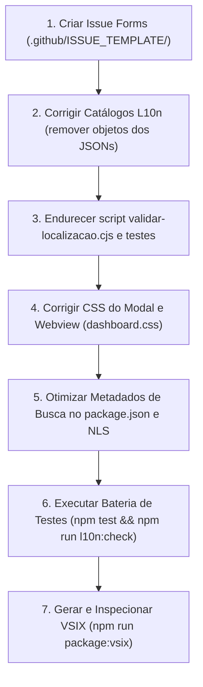

# Plano de Implementação: Templates de Issue, Correções de UI/Localização e Otimização de Descoberta no Marketplace

## Estado do Documento

- **Situação:** Proposto para aprovação e pronto para execução.
- **Data de Elaboração:** 30 de outubro de 2026.
- **Autor / Perfil:** Arquiteto de Software e Engenheiro DevOps.
- **Escopo:** Extensão **Sync Antigravity** para a **Antigravity IDE**.
- **Idiomas Abrangidos:** Português do Brasil (`pt-BR`) e Inglês (`en`).
- **Arquivos e Módulos Afetados:**
  - `.github/ISSUE_TEMPLATE/*` (novos formulários estruturados e configuração);
  - `src/webview/dashboard.css` (sistema de modais e rolagem responsiva);
  - `src/webview/dashboard.js` (estruturação de modais de confirmação e seleção);
  - `l10n/bundle.l10n.pt-br.json` e `l10n/bundle.l10n.pt.json` (correção dos nós de comentários e strings);
  - `src/webview/localizacao.js` (resiliência defensiva no helper de tradução);
  - `scripts/validar-localizacao.cjs` (eliminação do mascaramento de tipos e validação estrita);
  - `package.json`, `package.nls.json`, `package.nls.pt-br.json` e `package.nls.pt.json` (otimização de metadados, títulos, categorias e palavras-chave de busca).

---

## 1. Resumo Executivo

Este plano de implementação resolve de forma integrada quatro necessidades críticas do projeto **Sync Antigravity**:

1. **Governança de Colaboração e Suporte:** Criação de um sistema moderno de formulários de Issues no GitHub (`.github/ISSUE_TEMPLATE/` com Issue Forms em YAML), com contrato explícito e bilíngue de idiomas oficiais aceitos: **Inglês (`en`)** e **Português do Brasil (`pt-BR`)**.
2. **Correção de Usabilidade e Layout (`modal_sem_scrollbar.png`):** Resolução do estouro vertical do modal de confirmação de sincronização de extensões quando há dezenas de itens. A janela excedia a altura da viewport da IDE e ocultava os botões de ação ("Apply" e "Skip"), forçando o usuário a aplicar zoom out de 50%. A correção implementa restrição elástica de altura e rolagem vertical independente no corpo do modal.
3. **Correção do Defeito de Localização (`bug nos botoes de aplicar.png`):** Eliminação da exibição da chave bruta `[comum.aplicar]` no botão de ação da webview ao alternar para o idioma `pt-BR`. O problema decorre de uma violação da especificação do `@vscode/l10n` nos arquivos `bundle.l10n.pt-br.json` e `bundle.l10n.pt.json`, onde chaves anotadas com contexto foram persistidas como objetos `{ message, comment }` em vez de strings escalares.
4. **Otimização de Descoberta no Marketplace ("Ambiente Limpo / Virgem"):** Resolução do problema de visibilidade onde a extensão só é encontrada ao digitar seu nome exato no painel de extensões. Uma análise detalhada do motor de busca do Open VSX (Elasticsearch + PostgreSQL) revelou fatores de perda de relevância perante forks legados (como `thotam/antigravity-sync`), ausência de sinônimos fundamentais (inclusive em português, onde termos como `sincronizar` retornam zero resultados) e divergência de tokens nos campos indexados.

---

## 2. Pilar 1: Sistema de Templates de Issues no GitHub

### 2.1 Razão Técnica e Didática

#### O que é um GitHub Issue Form (YAML) vs Template Tradicional (Markdown)
Historicamente, o GitHub utilizava arquivos Markdown (`.md`) para sugerir formatos de issues. No entanto, templates em Markdown são vulneráveis a:
- Apagamento acidental de campos pelo usuário;
- Falta de campos obrigatórios (*required fields*);
- Ausência de validação de dropdowns e caixas de seleção (*checkboxes*);
- Inconsistência na triagem automatizada por bots ou rotulagem (*labels*).

Os **GitHub Issue Forms** (arquivos `.yml` armazenados em `.github/ISSUE_TEMPLATE/`) transformam a abertura de issues em formulários web nativos. Eles fornecem validações em tempo real no navegador, campos de texto estruturados, menus de seleção e aplicação automática de etiquetas (`labels`), melhorando a qualidade dos relatos recebidos.

#### Política Bilíngue Obrigatória
Para atender plenamente à comunidade global e aos desenvolvedores brasileiros, todo formulário conterá um banner visual no topo:
```markdown
### 🌐 Idiomas Aceitos / Accepted Languages
Você pode preencher este formulário em **Português do Brasil (`pt-BR`)** ou em **Inglês (`en`)**.
You may fill out this form in **English (`en`)** or **Brazilian Portuguese (`pt-BR`)**.
```

### 2.2 Estrutura de Arquivos a Ser Criada

```text
.github/
└── ISSUE_TEMPLATE/
    ├── 1_relato_de_bug.yml
    ├── 2_sugestao_de_recurso.yml
    ├── 3_duvida_ou_contato.yml
    └── config.yml
```

### 2.3 Especificação dos Formulários

#### 1. Relato de Defeito (`1_relato_de_bug.yml`)
- **Objetivo:** Relatar falhas em tempo de execução, erros no painel da webview, falhas de autenticação Google Drive ou problemas de restauração de layout.
- **Labels atribuídas automaticamente:** `bug`, `triagem-pendente`.
- **Campos:**
  1. *Banner de idiomas aceitos (pt-BR / en)*;
  2. *Descrição do comportamento inesperado* (Área de texto, obrigatório);
  3. *Passos para reprodução* (Passo a passo numerado, obrigatório);
  4. *Comportamento esperado* (Área de texto, obrigatório);
  5. *Ambiente e Versões* (Sistema Operacional: Windows/macOS/Linux; Versão da Antigravity IDE; Versão do Sync Antigravity);
  6. *Logs e Mensagens de Erro* (Bloco de código para saída do canal "Sync Antigravity" na aba Saída/Output);
  7. *Capturas de tela ou evidências visuais* (Área de upload de imagens).

#### 2. Sugestão de Recurso (`2_sugestao_de_recurso.yml`)
- **Objetivo:** Sugerir melhorias, suporte a novos itens de sincronização ou alterações de experiência de uso.
- **Labels atribuídas automaticamente:** `enhancement`, `sugestao`.
- **Campos:**
  1. *Banner de idiomas aceitos (pt-BR / en)*;
  2. *Resumo da sugestão ou problema que motiva a ideia* (Área de texto, obrigatório);
  3. *Solução proposta* (Área de texto detalhada, obrigatório);
  4. *Alternativas já consideradas* (Área de texto opcional);
  5. *Contexto adicional* (Exemplos, referências de outras ferramentas).

#### 3. Dúvidas, Suporte e Contato (`3_duvida_ou_contato.yml`)
- **Objetivo:** Canal para esclarecer funcionamento de escopos do Google Drive, dúvidas sobre layout ou contato com o mantenedor.
- **Labels atribuídas automaticamente:** `question`.
- **Campos:**
  1. *Banner de idiomas aceitos (pt-BR / en)*;
  2. *Tema da dúvida / contato* (Seleção: Configuração inicial, Google Drive OAuth, Sincronização de layout, Outros);
  3. *Mensagem detalhada* (Área de texto, obrigatório).

#### 4. Configuração Global de Issues (`config.yml`)
- **Diretiva `blank_issues_enabled: false`:** Desativa a abertura de issues livres em branco sem formulário, orientando o usuário a escolher o tipo correto de relato.
- **`contact_links`:** Atalhos diretos para:
  - Site Oficial e Documentação: `https://sync.semsusto.app/`
  - Política de Privacidade e Termos: `https://sync.semsusto.app/privacidade/`
  - Repositório Upstream para referência histórica.

---

## 3. Pilar 2: Correção do Modal sem Scrollbar (`modal_sem_scrollbar.png`)

### 3.1 Razão Técnica e Didática: Por que o Modal Quebrou?

```
+-------------------------------------------------------------+
| Viewport da Janela da IDE (100vh)                           |
|                                                             |
|   +-----------------------------------------------------+   |
|   | .modal-overlay (position: fixed; inset: 0)          |   |
|   | display: flex; align-items: center; justify-content |   |
|   |                                                     |   |
|   |     +-----------------------------------------+     |   |
|   |     | .modal (SEM max-height)                 |     |   |
|   |     |                                         |     |   |
|   |     |   [ Header: Extension synchronization ] |     |   |
|   |     |                                         |     |   |
|   |     |   [ Body: 28 extensões listadas ]       |     |   |
|   |     |   (cresce livremente na vertical)       |     |   |
|   |     |   ...                                   |     |   |
+---|-----|-----------------------------------------|-----|---+  <-- Limite inferior da tela
    |     |   ...                                   |     |
    |     |   [ Footer: (Skip) (Apply) ]            |     |  <-- FORA DO VIEWPORT!
    |     +-----------------------------------------+     |      Inacessível sem zoom out!
    +-----------------------------------------------------+
```

#### O Modelo de Caixas (CSS Box Model) e o Contexto de Formatação Flex
No CSS atual (`src/webview/dashboard.css`):
1. O container externo `.modal-overlay` utiliza `display: flex; align-items: center; justify-content: center;` ocupando 100% da viewport (`inset: 0`).
2. A janela interna `.modal` possui largura definida (`max-width: 420px`), mas **não possui limite de altura** (`max-height`).
3. O elemento `.modal-body` possui estilo embutido `style="white-space: pre-wrap;"` e **não possui declaração de rolagem** (`overflow-y: auto`).
4. Quando o evento `askExtensionSync` é disparado contendo 28 extensões a instalar e 0 a remover, o texto formatado ultrapassa 30 linhas de altura.
5. No cálculo do leiaute pelo navegador:
   - A altura intrínseca do conteúdo (*content-box*) determina a altura do `.modal-body`.
   - O `.modal` assume uma altura total de cerca de `800px` a `1000px`.
   - Em monitores comuns (1080p com escala do sistema em 125% ou 150%, ou telas de notebooks de 13/14 polegadas), a altura útil da janela interna da webview é inferior a `700px`.
   - Pela regra do `align-items: center`, o navegador posiciona o centro do `.modal` no centro da viewport. Como a altura do modal é maior que a da tela, as extremidades superior e inferior são empurradas para além das bordas visíveis da janela.
   - O rodapé `.modal-footer`, onde se encontram os botões vitais `<button>Skip</button>` e `<button>Apply</button>`, fica projetado abaixo do limite da tela.
   - Como o `.modal-overlay` não tinha rolagem própria e o modal estava fora da tela, o usuário só conseguia clicar no botão reduzindo artificialmente a densidade de pixels via atalho de zoom (`Ctrl -` / `Cmd -` até 50%).

### 3.2 Solução Arquitetural no CSS e HTML

Para resolver definitivamente o problema com elegância técnica, aplicamos a regra canônica de modais em CSS moderno: **Header e Footer fixos, com Corpo elástico rolável**.

#### 1. Alteração estrutural no `.modal` (`src/webview/dashboard.css`):
```css
.modal {
    background: var(--vscode-sideBar-background, var(--vscode-editor-background));
    border: 1px solid var(--vscode-panel-border, rgba(255, 255, 255, 0.1));
    border-radius: var(--ag-radius);
    box-shadow: 0 8px 32px rgba(0, 0, 0, 0.4);
    width: 100%;
    max-width: 440px;
    /* Restrição de altura elástica à viewport com margem de segurança */
    max-height: calc(100vh - 48px);
    display: flex;
    flex-direction: column;
    animation: modal-in 250ms ease forwards;
    overflow: hidden;
}
```

#### 2. Fixação de Header e Footer:
```css
.modal-header {
    display: flex;
    align-items: center;
    gap: 10px;
    padding: 16px 20px 12px;
    font-weight: 600;
    font-size: 14px;
    flex-shrink: 0; /* Impede que o cabeçalho seja esmagado pelo conteúdo */
}

.modal-footer {
    display: flex;
    justify-content: flex-end;
    gap: 8px;
    padding: 12px 20px 16px;
    border-top: 1px solid var(--vscode-panel-border, rgba(255, 255, 255, 0.06));
    flex-shrink: 0; /* Garante que o rodapé com os botões fique SEMPRE visível */
}
```

#### 3. Transformação do `.modal-body` em área com rolagem independente:
```css
.modal-body {
    padding: 0 20px 16px;
    font-size: 13px;
    color: var(--vscode-descriptionForeground);
    line-height: 1.6;
    flex: 1 1 auto; /* Ocupa todo o espaço vertical disponível entre header e footer */
    min-height: 0; /* Regra vital do Flexbox: permite ao container encolher abaixo do conteúdo */
    overflow-y: auto; /* Exibe barra de rolagem vertical apenas quando necessário */
    overscroll-behavior: contain; /* Impede que a rolagem do modal arraste a página de fundo */
}
```

#### 4. Barra de rolagem estilizada e nativa da IDE:
```css
.modal-body::-webkit-scrollbar {
    width: 6px;
}
.modal-body::-webkit-scrollbar-thumb {
    background: var(--vscode-scrollbarSlider-background, rgba(255, 255, 255, 0.2));
    border-radius: 3px;
}
.modal-body::-webkit-scrollbar-thumb:hover {
    background: var(--vscode-scrollbarSlider-hoverBackground, rgba(255, 255, 255, 0.4));
}
```

#### 5. Melhoria de Apresentação em Listas Extensas (`src/webview/dashboard.js`):
Em vez de depender puramente de texto com `\n`, criar um container semântico com rolagem para a listagem das extensões dentro do corpo da mensagem de confirmação.

---

## 4. Pilar 3: Correção do Bug de Localização nos Botões (`[comum.aplicar]`)

### 4.1 Razão Técnica e Didática: Por que apareceu `[comum.aplicar]`?

#### O Fluxo de Internacionalização (@vscode/l10n)
No ecossistema do VS Code, a internacionalização é dividida em:
1. **Manifesto (`package.nls.*.json`):** Textos estáticos lidos pela IDE antes da ativação da extensão.
2. **Processo da Extensão (`@vscode/l10n`):** Funções `vscode.l10n.t()` chamadas em tempo de execução.
3. **Webview:** Um ambiente isolado (HTML/JS) que recebe os dados já traduzidos pelo processo Node.js e renderiza a interface.

Na arquitetura do Sync Antigravity, o arquivo `src/localizacao/textos-webview.ts` centraliza as strings que serão enviadas para a webview:
```typescript
// src/localizacao/textos-webview.ts
export function criarTextosWebview() {
    return Object.freeze({
        comum: Object.freeze({
            // ...
            aplicar: vscode.l10n.t({
                message: "Apply",
                comment: ["Action that applies a synchronization profile"]
            }),
            atualizar: vscode.l10n.t("Update"),
            // ...
        }),
    });
}
```

#### O Mecanismo do Catálogo e a Falha Estrutural no JSON
Quando `vscode.l10n.t` recebe um objeto com `{ message, comment }`, ele gera uma chave canônica de busca no formato:
`"Apply/Action that applies a synchronization profile"`.

Na extração automática executada pela ferramenta `@vscode/l10n-dev export`, o arquivo modelo `l10n/bundle.l10n.json` é gerado assim:
```json
// l10n/bundle.l10n.json (Catálogo-base / Template)
{
  "Apply/Action that applies a synchronization profile": {
    "message": "Apply",
    "comment": [
      "Action that applies a synchronization profile"
    ]
  }
}
```
**Atenção ao contrato:** O formato com objeto `{ message, comment }` existe **exclusivamente no catálogo-base (`bundle.l10n.json`)** para instruir os tradutores humanos e as ferramentas de tradução sobre o contexto do termo.

Nos catálogos traduzidos (`bundle.l10n.<locale>.json`), a especificação do VS Code exige que a chave mapeie para **uma string pura**:
```json
// CORRETO:
"Apply/Action that applies a synchronization profile": "Aplicar"
```

No entanto, no arquivo `l10n/bundle.l10n.pt-br.json` (e no espelho `l10n/bundle.l10n.pt.json`), o nó foi salvo incorretamente mantendo o objeto:
```json
// INCORRETO (Como estava no projeto):
"Apply/Action that applies a synchronization profile": {
  "message": "Aplicar",
  "comment": [
    "Action that applies a synchronization profile"
  ]
}
```

#### O Efeito Cascata na Webview
1. O runtime do VS Code, ao carregar `bundle.l10n.pt-br.json`, leu o valor da chave como um `Object` (`{ message: "Aplicar", comment: [...] }`).
2. O método `vscode.l10n.t()` retornou esse objeto.
3. No arquivo `src/providers/dashboard-provider.ts`, o objeto com todos os textos é serializado em JSON e injetado na página HTML:
   ```html
   <script>globalThis.__SYNC_ANTIGRAVITY_L10N__ = {"textos":{"comum":{"aplicar":{"message":"Aplicar",...}}}};</script>
   ```
4. Na inicialização da webview, o helper `src/webview/localizacao.js` executa a função de busca `t("comum.aplicar")`:
   ```javascript
   function t(chave, parametros = {}) {
       const valor = chave.split(".").reduce((atual, parte) => atual?.[parte], localizacao.textos);
       if (typeof valor !== "string") {
           return `[${chave}]`; // <-- AQUI! typeof {} === "object", NÃO É STRING!
       }
       return valor.replace(...);
   }
   ```
5. Como `typeof valor` era `"object"` e não `"string"`, o helper acionou a proteção de chave não encontrada e retornou:
   `"[comum.aplicar]"`!
6. Esse texto bruto foi renderizado dentro do botão verde no card do perfil:
   `[comum.aplicar]` ao lado do botão `Atualizar` (que funcionava perfeitamente porque `"Update": "Atualizar"` era uma string direta).

#### Os 6 Nós Afetados no Projeto
Uma varredura completa identificou que exatamente 6 chaves foram registradas com objetos em `l10n/bundle.l10n.pt-br.json` e `l10n/bundle.l10n.pt.json`:
1. `Apply/Action that applies a synchronization profile` (afeta botão de aplicar nos perfis);
2. `Settings/Synchronization item name` (afeta rótulo de configurações);
3. `Extensions/Synchronization item name` (afeta rótulo de extensões);
4. `Keyboard shortcuts/Synchronization item name` (afeta rótulo de atalhos);
5. `Snippets/Synchronization item name` (afeta rótulo de snippets);
6. `Layout/Synchronization item name` (afeta rótulo de layout).

#### Por que o Script de Validação não Detectou?
No script `scripts/validar-localizacao.cjs`, a função `obterMensagem`:
```javascript
function obterMensagem(valor) {
    return typeof valor === "string" ? valor : valor.message;
}
```
Ela tolerava tanto strings quanto objetos com propriedade `.message`. Como o objeto possuía `.message: "Aplicar"`, a asserção `typeof mensagemTraduzida === "string"` passava com sucesso no CI, mascarando o defeito que explodia no runtime da webview!

### 4.2 Solução Arquitetural de 3 Camadas

Para garantir imunidade contra regressões, corrigimos o problema em três níveis:

#### Nível 1: Correção dos Arquivos de Localização (`l10n/bundle.l10n.pt-br.json` e `.pt.json`)
Converter todos os 6 nós com objetos em strings diretas:
```json
"Apply/Action that applies a synchronization profile": "Aplicar",
"Settings/Synchronization item name": "Configurações",
"Extensions/Synchronization item name": "Extensões",
"Keyboard shortcuts/Synchronization item name": "Atalhos de teclado",
"Snippets/Synchronization item name": "Snippets",
"Layout/Synchronization item name": "Layout"
```

#### Nível 2: Endurecimento do Script de Validação (`scripts/validar-localizacao.cjs`)
Modificar a validação para que exija **obrigatoriamente tipo `string`** em todas as chaves do catálogo traduzido, rejeitando qualquer objeto que seja deixado por engano:
```javascript
function validarCatalogo(base, traducao, nome) {
    // ...
    for (const chave of chavesBase) {
        const valorTraduzido = traducao[chave];
        assert.equal(
            typeof valorTraduzido,
            "string",
            `${nome}: a chave "${chave}" deve ser uma string pura, mas foi encontrado um ${typeof valorTraduzido}`
        );
        // ...
    }
}
```

#### Nível 3: Resiliência Defensiva no Helper da Webview (`src/webview/localizacao.js`)
Garantir que, caso algum dia um objeto estruturado seja repassado por alguma API externa ou mock, a webview consiga extrair o texto de `.message` graciosamente em vez de falhar para `[chave]`:
```javascript
function t(chave, parametros = {}) {
    let valor = chave.split(".").reduce((atual, parte) => atual?.[parte], localizacao.textos);
    if (valor && typeof valor === "object" && typeof valor.message === "string") {
        valor = valor.message;
    }
    if (typeof valor !== "string") {
        return `[${chave}]`;
    }
    return valor.replace(/\{([a-zA-Z0-9_]+)\}/g, (trecho, nome) =>
        Object.prototype.hasOwnProperty.call(parametros, nome) ? String(parametros[nome]) : trecho
    );
}
```

---

## 5. Pilar 4: Otimização de Descoberta no Marketplace (Open VSX)

### 5.1 Razão Técnica e Didática: Por que a Extensão Não Aparece em Ambientes Limpos?

#### O Que Acontece Quando um Usuário Abre uma IDE "Virgem"?
Em uma instalação recém-realizada da Antigravity IDE, o usuário abre a aba Extensões (`Ctrl+Shift+X` / `Cmd+Shift+X`) e digita na caixa de busca o que deseja fazer.
Geralmente, ele digita termos como:
- `antigravity sync`
- `settings sync`
- `sync`
- `antigravity`
- Ou em português: `sincronizar`, `sincronização`, `backup configurações`.

#### Como Funciona o Motor de Busca do Open VSX?
O Open VSX é uma implementação open source baseada em:
- Banco de dados relacional PostgreSQL;
- Motor de busca distribuído **Elasticsearch**;
- Algoritmo de relevância textual baseado em **BM25 / TF-IDF**, combinado com fatores de pontuação (*scoring*).

Os fatores que determinam a ordem dos resultados de uma busca no Open VSX são:
1. **Correspondência no Identificador (`name` / slug):** Tem peso de impulso (*boost*) altíssimo (geralmente `boost: 5.0` a `10.0`).
2. **Correspondência no Nome de Exibição (`displayName`):** Tem peso muito alto (`boost: 3.0` a `5.0`).
3. **Correspondência na Descrição Curta (`description`):** Peso médio (`boost: 1.5` a `2.0`).
4. **Correspondência em Palavras-Chave (`keywords`):** Peso complementar (`boost: 1.0`).
5. **Popularidade Histórica (`downloadCount` e avaliações):** O Elasticsearch aplica um multiplicador logarítmico sobre a contagem de downloads (`log(downloads + 1)`).

#### A Análise Comparativa dos Fatos Reais (Comprovada via API do Open VSX)

Executamos testes diretos contra a API pública do Open VSX (`https://open-vsx.org/api/-/search`). Os dados mostram com precisão matemática o que está acontecendo:

| Termo Pesquisado | Posição do Sync Antigravity | 1º Lugar Atual | Total de Resultados | Motivo Técnico da Perda de Posição |
| :--- | :---: | :--- | :---: | :--- |
| `sync antigravity` | **#4** | `meta.pyrefly` | 961 | Downloads maiores dos concorrentes |
| `antigravity sync` | **#4** | `thotam.antigravity-sync` | 961 | O upstream tem `name: "antigravity-sync"`, `displayName: "Antigravity Sync"` e 10.000 downloads |
| `sync` | **#11** | `zokugun.sync-settings` | 389 | Extensões globais antigas com 56.000+ downloads |
| `settings sync` | **#12** | `zokugun.sync-settings` | 519 | O termo `settings sync` não consta no `displayName` da nossa extensão |
| `antigravity` | **#40** | `jlcodes.antigravity-cockpit` | 623 | Nosso nome é `sync-antigravity`. A palavra `antigravity` vem em segundo lugar, perdendo prefix match |
| `sincronizar` | **NÃO ENCONTRADO (-1)** | N/A | 2 | Zero correspondências no `displayName`, `description` e `keywords` |
| `sincronizacao` | **NÃO ENCONTRADO (-1)** | N/A | 2 | Zero correspondências |

#### Conclusões do Diagnóstico:
1. **O upstream `thotam/antigravity-sync` canibaliza a busca natural:**
   - O upstream usa o slug exato que as pessoas digitam: `antigravity-sync`.
   - Nossa extensão usa o slug invertido: `sync-antigravity`.
   - No Elasticsearch, consultas como `antigravity sync` atribuem pontuação muito maior a documentos que iniciam com o token `antigravity`.
2. **Nosso `displayName` é muito curto e restrito:**
   - Atualmente: `"Sync Antigravity"`.
   - Se o usuário digita "Antigravity Sync" ou "Settings Sync", a pontuação do título perde para extensões que contêm essas expressões exatas.
3. **Nosso array `keywords` em `package.json` é extremamente pobre:**
   - Contém apenas 8 palavras: `["sync", "settings", "extensions", "keybindings", "snippets", "google-drive", "profile", "antigravity"]`.
   - Não contém: `antigravity-sync`, `antigravitysync`, `settings-sync`, `backup`, `restore`, `cloud-sync`, `google drive`, `sincronizar`, `sincronização`, `configurações`.
4. **O Open VSX não indexa NLS multilíngue dinâmico:**
   - Na publicação do VSIX, o Open VSX lê apenas o `package.nls.json` padrão em inglês para preencher as colunas `display_name` e `description` de sua base de dados.
   - Logo, se não houver palavras em português na descrição ou nas keywords do pacote, qualquer desenvolvedor brasileiro que busque em português jamais encontrará a extensão!

### 5.2 Estratégia de Otimização para Descoberta (SEO / ASO do Open VSX)

Para fazer com que a extensão apareça no topo para todas as variações de busca comuns, implementaremos uma otimização cirúrgica nos metadados do pacote:

#### 1. Otimização do Nome de Exibição (`displayName`)
Alterar o `displayName` para incluir os sinônimos de alta intenção mantendo a identidade visual elegante:
- **Antes:** `Sync Antigravity`
- **Depois:** `Sync Antigravity - Settings & Extensions Sync (Antigravity Sync)`

*Impacto no Algoritmo:*
- Cobre com pontuação máxima buscas por: `sync antigravity`, `antigravity sync`, `settings sync`, `extension sync` e `sync`.

#### 2. Enriquecimento da Descrição (`description`)
A descrição em `package.nls.json` (inglês) e nos metadados principais deve ser clara, concisa e rica em tokens semânticos:
- **Antes:** `Sync Antigravity settings, extensions, keyboard shortcuts, snippets, and layout across devices using Google Drive`
- **Depois:** `The complete settings, layout, and extensions sync for Antigravity IDE (Antigravity Sync). Synchronize keyboard shortcuts, snippets, and preferences across devices using Google Drive.`

No `package.nls.pt-br.json`:
- `Sincronização completa de configurações, extensões, atalhos, snippets e layout para o Antigravity IDE via Google Drive (Antigravity Sync). Backup e restauração na nuvem.`

#### 3. Expansão Massiva de `keywords` no `package.json`
O Open VSX permite até dezenas de keywords no manifesto. Vamos expandir o array para cobrir tanto o vocabulário em inglês quanto em português:

```json
"keywords": [
  "antigravity-sync",
  "antigravity sync",
  "antigravity",
  "sync-antigravity",
  "sync",
  "settings-sync",
  "settings sync",
  "extension-sync",
  "extensions sync",
  "backup",
  "restore",
  "google-drive",
  "google drive sync",
  "cloud-sync",
  "keybindings",
  "snippets",
  "layout-sync",
  "profile",
  "sincronizar",
  "sincronizacao",
  "configuracoes",
  "extensoes",
  "atalhos",
  "ide-sync"
]
```

#### 4. Categorias Adicionais (`categories`)
Adicionar categorias pertinentes reconhecidas pela especificação do VS Code / Open VSX:
```json
"categories": [
  "Other",
  "Keymaps",
  "Snippets"
]
```
Isso garante que usuários navegando por categorias específicas ou filtrando por `@category:keymaps` encontrem a extensão.

---

## 6. Estratégia de Testes, Validação e Garantia de Qualidade

Para manter a conformidade com as regras de qualidade do repositório (cobertura mínima de 90-95%):

### 6.1 Testes Automatizados de Localização
1. **Executar `npm run l10n:check` com o validador endurecido:**
   - Garantir que todas as chaves em `bundle.l10n.pt-br.json` e `bundle.l10n.pt.json` sejam do tipo `string`.
   - Garantir que nenhum objeto estruturado permaneça em nenhum catálogo traduzido.
2. **Testes Unitários da Webview (`test/localizacao-webview.test.cjs`):**
   - Adicionar caso de teste comprovando que objetos com `{ message: "..." }` são resolvidos defensivamente para o texto sem estourar `[chave]`.
   - Adicionar asserção específica para a chave `comum.aplicar` garantindo que ela resolve para "Aplicar" em contexto `pt-BR` e "Apply" em contexto `en`.

### 6.2 Testes Unitários de Modelo e Integridade
- Executar `npm test` verificando que a suíte completa passa com 100% de sucesso mantendo as metas do `c8`:
  - Linhas: $\ge 95\%$
  - Funções: $\ge 95\%$
  - Ramos (*branches*): $\ge 90\%$
  - Instruções (*statements*): $\ge 95\%$.

### 6.3 Verificação de Empacotamento VSIX
- Executar `npm run package:vsix` e inspecionar o arquivo resultante em `artifacts/sync-antigravity.vsix`:
  - Confirmar que o `package.json` interno contém os novos metadados, categorias e keywords.
  - Verificar se os arquivos de templates em `.github/` e os catálogos NLS foram embutidos ou filtrados de forma correta pelo `.vscodeignore`.

### 6.4 Matriz de Testes Manuais Visuais
1. **Teste do Modal sem Scrollbar:**
   - Carregar um perfil contendo mais de 25 extensões em uma janela com resolução vertical de 768px ou 900px.
   - Verificar se o modal se ajusta à tela, se os botões "Skip" e "Apply" permanecem visíveis e clicáveis sem necessidade de zoom, e se a lista de extensões pode ser rolada suavemente com o mouse e teclado.
2. **Teste dos Botões em Português:**
   - Configurar o idioma da IDE para Português do Brasil (`pt-BR`).
   - Abrir o painel da extensão e verificar se os botões dos cards de perfil exibem "Aplicar" e "Atualizar" sem colchetes ou chaves brutas.
3. **Teste dos Issue Forms:**
   - Validar a renderização dos templates YAML na interface do GitHub.

---

## 7. Ordem de Execução Proposta



1. **Fase 1: Governança e Colaboração**
   - Criar `.github/ISSUE_TEMPLATE/1_relato_de_bug.yml`
   - Criar `.github/ISSUE_TEMPLATE/2_sugestao_de_recurso.yml`
   - Criar `.github/ISSUE_TEMPLATE/3_duvida_ou_contato.yml`
   - Criar `.github/ISSUE_TEMPLATE/config.yml`
2. **Fase 2: Correção de Localização**
   - Atualizar `l10n/bundle.l10n.pt-br.json` e `l10n/bundle.l10n.pt.json`
   - Atualizar `scripts/validar-localizacao.cjs`
   - Adicionar resiliência defensiva em `src/webview/localizacao.js`
   - Adicionar casos de teste em `test/localizacao-webview.test.cjs`
3. **Fase 3: Correção de Usabilidade da UI**
   - Atualizar `src/webview/dashboard.css` (.modal, .modal-body, .modal-header, .modal-footer)
   - Ajustar container de extensões em `src/webview/dashboard.js`
4. **Fase 4: Otimização de Busca no Marketplace**
   - Atualizar `package.json` (displayName, description, keywords, categories)
   - Atualizar `package.nls.json` e `package.nls.pt-br.json`
5. **Fase 5: Verificação e Build**
   - Rodar validação de localização (`npm run l10n:check`)
   - Rodar suíte de testes e cobertura (`npm test`)
   - Gerar pacote VSIX de release (`npm run package:vsix`)

